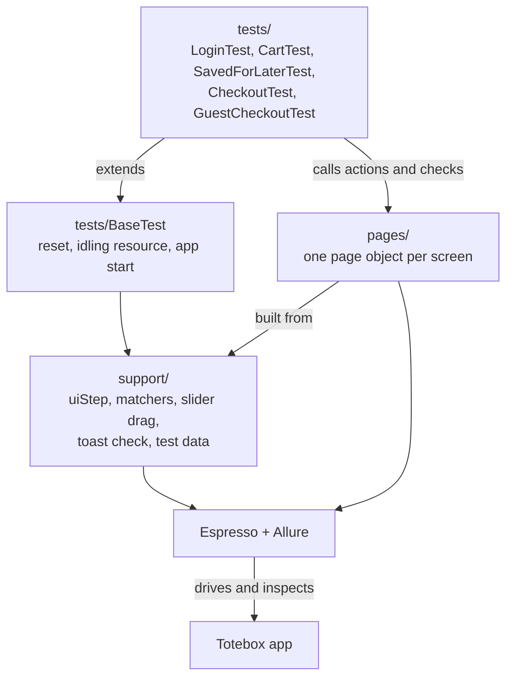
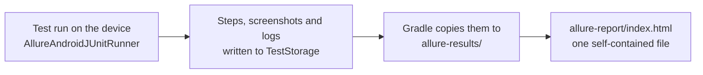
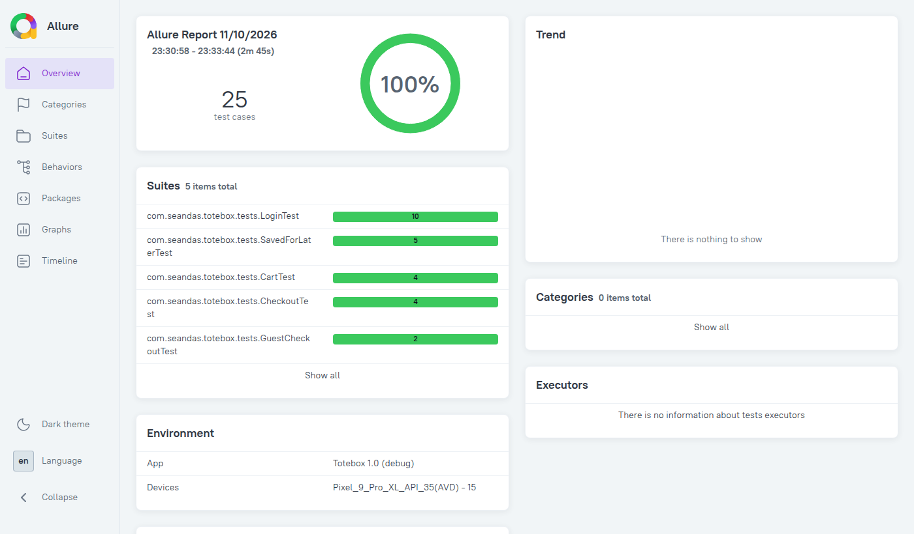
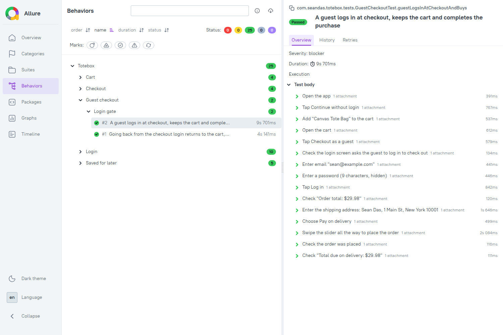
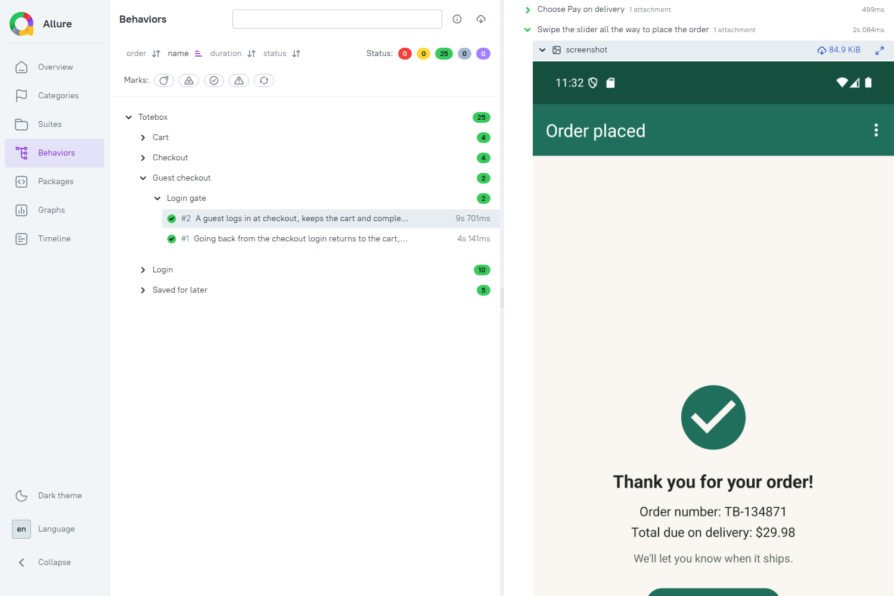
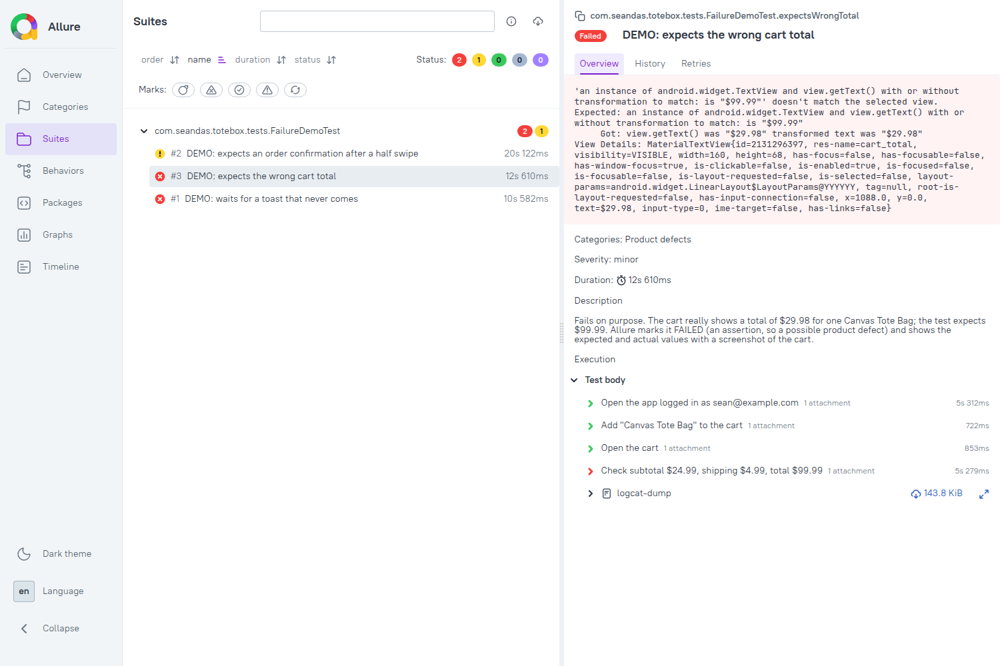

# Totebox

[](https://github.com/seandas/totebox-espresso-test/actions/workflows/ci.yml)

A small Android shopping app, built as a realistic target for UI test automation.
It is written in Kotlin with classic Android views (not Compose), so it suits Espresso testing.
It needs no server: products, accounts and orders are built in and kept in memory.

## What it does

| Screen | Behaviour worth testing |
|---|---|
| Login | Helper text for each field; required-field, email-format and password-rule errors; locked account; loading state; a "Logged in as …" toast on success; "Continue without login" to browse as a guest |
| Products | List loads after a short simulated network delay; sort by name or price; add to cart with a badge count; "Save for later" hides the product from the list (with a toast) until it is moved back to the cart or deleted from the saved items |
| Product details | Quantity stepper (1 to 10); add to cart with a snackbar and "View cart" action; at most 10 of a product, with a "limit" message past that |
| Cart | Change quantities, remove items, empty state, subtotal, shipping (free from $50, otherwise $4.99), total |
| Saved for later | A second tab on the cart screen; "Save for later" moves a cart item there, where it can be moved back to the cart or deleted |
| Checkout | Guests must log in first (their cart is kept); shipping form and card validation (5-digit ZIP, 16-digit card, MM/YY expiry not in the past, 3-digit CVV); pay on delivery hides the card fields; the order is placed with a "Swipe to place order" slider (letting go early slides it back; an invalid form shows its errors and resets it; TalkBack and the keyboard can confirm it too) |
| Order placed | Order number (`TB-` and 6 digits) and total; back returns to the store |
| Crash test item | Always last in the product list; adding it to the cart (from the list or its details screen) crashes the app on purpose with an `IndexOutOfBoundsException` (`util/CrashTest.kt`) |
| Menu (⋮) | Home, Saved items, Settings, and Log out (Log in for guests) |
| Settings | Account, simulated network speed (normal, fast, slow), version and disclaimer |

Logging in (there is no server, so no account has to exist):

| Email | Password | Result |
|---|---|---|
| Any valid address, e.g. `sam@example.com` | 8+ characters with a number and a special character, e.g. `secret#42` | Logs in |
| `locked@totebox.app` | Any password that meets the rules | "This account is locked" |
| Not a valid address, e.g. `sam@example` | Any | "Enter a valid email address" |
| Any valid address | Too short, or missing a number or special character | Password rule error |

A special character is anything other than a letter, a digit or a space.

This is a demo store: no real payment is taken, and the card fields are only validated.

## Built for testing

- Every interactive view has a stable resource ID (for example `login_button`, `cart_badge`,
  `qty_plus`, `save_button`, `cart_item_save`, `saved_item_move`), and icon-only buttons have content descriptions.
  The cart screen's tabs have the IDs `tab_cart` and `tab_saved`.
- Simulated network calls (login, loading products, placing an order) go through `FakeNetwork`
  and are counted by an Espresso `CountingIdlingResource`, `AppIdling.resource`
  (`util/AppIdling.kt`). Register it with `IdlingRegistry` and tests wait for these calls
  without sleeps.
- `FakeNetwork.delayScale` changes every simulated delay: `0f` for a fast suite, higher to
  check loading states. The Settings screen sets the same value.
- State lives in memory only. `Session.logOut()` resets the login, guest mode, the cart and the
  saved items, so call it between tests. `Session.logIn(email)` or `Session.continueAsGuest()`
  let a test skip the login screen.
- Animations are disabled for instrumented test runs (`testOptions.animationsDisabled`).
- The business rules live in plain Kotlin objects with JVM unit tests: `data/LoginRules.kt`,
  `data/Session.kt`, `data/Cart.kt` (limits, shipping, saved for later) and
  `data/CheckoutValidator.kt`.

## Project layout

```
Totebox/
├── app/
│   ├── build.gradle.kts              App build, test dependencies and the Allure report tasks
│   └── src/
│       ├── main/                     THE APP
│       │   ├── AndroidManifest.xml
│       │   ├── java/com/seandas/totebox/
│       │   │   ├── data/             Business rules, no Android dependencies
│       │   │   │   ├── Catalog.kt, Product.kt      The 8 products and the crash test item
│       │   │   │   ├── Cart.kt                     Cart lines, limits, shipping, saved for later
│       │   │   │   ├── Session.kt, LoginRules.kt   Login, guest mode and the login rules
│       │   │   │   └── CheckoutValidator.kt        ZIP, card, expiry and CVV rules
│       │   │   ├── ui/               One activity per screen
│       │   │   │   ├── ShopActivity.kt             Shared toolbar, menu and cart badge
│       │   │   │   ├── LoginActivity.kt … SettingsActivity.kt
│       │   │   │   ├── ProductAdapter.kt, CartAdapter.kt, SavedAdapter.kt
│       │   │   │   └── widget/SwipeToConfirmView.kt   The "Swipe to place order" slider
│       │   │   └── util/             FakeNetwork and its idling resource, prices, the deliberate crash
│       │   └── res/                  Layouts, strings, icons, theme
│       │
│       ├── test/                     JVM UNIT TESTS (no device)
│       │   └── java/com/seandas/totebox/data/
│       │       └── CartTest, SessionTest, LoginRulesTest, CheckoutValidatorTest, CatalogTest
│       │
│       └── androidTest/              ESPRESSO UI TESTS (emulator or device)
│           ├── java/com/seandas/totebox/
│           │   ├── tests/            What is checked
│           │   │   ├── BaseTest.kt                 Shared setup and teardown
│           │   │   ├── LoginTest.kt, CartTest.kt, SavedForLaterTest.kt,
│           │   │   │   CheckoutTest.kt, GuestCheckoutTest.kt
│           │   │   └── FailureDemoTest.kt          Fails on purpose (skipped by default)
│           │   ├── pages/            How each screen is driven (page objects)
│           │   │   └── LoginPage, ProductsPage, CartPage, SavedForLaterPage,
│           │   │       CheckoutPage, OrderPlacedPage
│           │   └── support/          Shared building blocks
│           │       ├── AllureSteps.kt              uiStep: a report step with a screenshot
│           │       ├── Matchers.kt, ListMatchers.kt   Field errors, helper text, list rows
│           │       ├── SwipeActions.kt             Dragging the slider handle
│           │       ├── ToastWatcher.kt             Checking toasts
│           │       ├── TestData.kt, Products.kt    Inputs and product names
│           │       └── FailureDemo.kt              The @FailureDemo annotation
│           └── resources/allure.properties         Where Allure writes its results
│
├── .github/workflows/ci.yml          CI: build, lint, unit tests and UI tests on an emulator
├── allure-results/                   Raw results of the last UI run   (generated, git-ignored)
├── allure-report/index.html          The HTML report of the last run  (generated, git-ignored)
├── build.gradle.kts, settings.gradle.kts, gradle.properties, gradlew
└── README.md, LICENSE
```

## Build and run

Requires Android Studio, or JDK 17+ with the Android SDK. Minimum Android 8.0 (API 26); targets API 34.

```
./gradlew assembleDebug
./gradlew installDebug
```

## Tests

```
./gradlew testDebugUnitTest                         # 29 JVM unit tests, no device needed
./gradlew connectedDebugAndroidTest                 # 25 Espresso UI tests on a running emulator or device
./gradlew connectedDebugAndroidTest -PfailureDemo   # only the 3 tests that fail on purpose
./gradlew allureReport                              # rebuild the HTML report from the last UI run
```

| Layer | Where | Tests | What it checks |
|---|---|---|---|
| Unit | `app/src/test` | 29 | The rules in `data/`: cart limits and shipping, saved for later, login rules, session, checkout validation |
| UI | `app/src/androidTest` | 25 | The app through its screens, as a user would use it |
| Failure demo | `tests/FailureDemoTest.kt` | 3 | Nothing: they fail on purpose to show the failure report |

Rules are tested at the unit level, where every edge case is cheap. The UI tests check that the
screens are wired to those rules and that the flows across screens work.

## Test architecture

### Three layers



- **Tests** say what is checked, in the user's terms. They contain no Espresso calls; they call
  page objects.
- **Pages** know how each screen is driven: which views to find, how to act on them and how to
  check them. A change to a screen's layout is fixed in one page class.
- **Support** holds what several pages share: the report step, custom matchers and actions,
  and test data.

### The page object pattern

Each screen has one class in `pages/`, written to four rules:

1. **Locators are private.** Views are found inside the page (`onView(withId(R.id.login_button))`)
   and never exposed to tests.
2. **Actions return a page.** An action that stays on the screen returns the same page
   (`enterEmail(...)`); one that moves to another screen returns that screen's page
   (`tapCheckout()` returns a `CheckoutPage`). Tests therefore read as one chain, and the
   compiler stops a test from calling a cart action while on the login screen.
3. **Checks start with `check`** (`checkTotals(...)`, `checkEmailError(...)`) and also return
   the page, so actions and checks interleave in the chain.
4. **Every action and check is a report step.** Each one runs inside `uiStep("…")`, which
   names the step in plain words and attaches a screenshot.

A test then reads like the scenario it checks:

```kotlin
@Test
@DisplayName("A guest logs in at checkout, keeps the cart and completes the purchase")
fun guestLogsInAtCheckoutAndBuys() {
    openApp()
        .continueWithoutLogin()                 // LoginPage    -> ProductsPage
        .addToCart(TOTE)
        .openCart()                             // ProductsPage -> CartPage
        .tapCheckoutAsGuest()                   // CartPage     -> LoginPage
        .checkCheckoutGate()
        .logInToCheckOut(TestData.VALID_EMAIL, TestData.VALID_PASSWORD)   // -> CheckoutPage
        .checkOrderTotal("$29.98")
        .enterShippingAddress(TestData.NAME, TestData.ADDRESS, TestData.CITY, TestData.ZIP)
        .choosePayOnDelivery()
        .swipeToPlaceOrder()                    // CheckoutPage -> OrderPlacedPage
        .checkIsShown()
        .checkTotal("$29.98", payOnDelivery = true)
}
```

Rows in lists (products, cart lines, saved items) are addressed by product name, and their
buttons by the accessibility label each one carries, such as "Remove Canvas Tote Bag from cart".
The tests therefore also fail if those labels go missing.

### Test lifecycle

Every test class extends `BaseTest`, which makes each test independent of the others:

| When | What `BaseTest` does | Why |
|---|---|---|
| Before each test | `Session.logOut()` | The app keeps state in memory; this clears the login, the cart and the saved items |
| | `FakeNetwork.delayScale = 0f` | The simulated network calls return at once, which keeps the suite fast |
| | Registers `AppIdling.resource` | Espresso waits for those calls instead of sleeping |
| Start | `openApp()` or `openAppLoggedIn()` | Start at the login screen, or logged in on the product list for tests that are not about login |
| After each test | Closes the screen, unregisters the idling resource, restores the delay, logs out | Leaves nothing behind for the next test |
| On failure | `LogcatRule` | Attaches the device log to the report |

### Waiting without sleeps

There is no `Thread.sleep` in the suite. The app counts its simulated network calls in a
`CountingIdlingResource`; with it registered, Espresso waits until they finish before each
action and check. `uiStep` also waits for the app to be idle before taking its screenshot.

### Custom Espresso pieces

| Piece | File | What it is for |
|---|---|---|
| `uiStep` | `support/AllureSteps.kt` | Wraps an action or check as an Allure step with a screenshot; on failure attaches a failure screenshot and rethrows |
| `dragSliderHandle(fraction)` | `support/SwipeActions.kt` | Drags the slider's handle from where it is to a point on the track (0.5 = halfway). A plain `swipeRight()` starts at a fixed point and can miss the handle |
| `expectToast(text) { … }` | `support/ToastWatcher.kt` | Checks a toast appears while an action runs. Espresso can't see toasts on recent Android versions, so this listens for the accessibility event each toast sends |
| `hasError`, `hasHelperText` | `support/Matchers.kt` | The error and helper text of a Material text field |
| `withTextMatching(regex)` | `support/Matchers.kt` | Text that changes each run, such as the order number `TB-######` |
| `inRow`, `listHasRow` | `support/ListMatchers.kt` | A view inside the list row for a product; whether a product is anywhere in a list, on screen or not |
| `string(R.string.…)` | `support/TestData.kt` | Expected texts come from the app's own resources, so a wording change does not break tests |

### Continuous integration

`.github/workflows/ci.yml` runs on every push to `main` and every pull request:

| Job | What it does |
|---|---|
| Build, lint and unit tests | Builds the app, runs Android lint and the JVM unit tests |
| Espresso UI tests | Starts an API 34 emulator (Pixel 6 profile) on GitHub's Linux runner and runs the UI suite |

The Allure report of each run is attached to the run as the `allure-report` artifact, whether
the tests pass or fail: open the run on the Actions tab, download the artifact and open
`index.html`.

### What the UI tests cover

| Class | Tests | Covers |
|---|---|---|
| `LoginTest` | 10 | Valid login and its toast, field requirements, required fields, invalid email, each password rule, locked account, errors clearing while typing, continuing as a guest |
| `CartTest` | 4 | Quantity buttons and totals, free shipping just over $50, removing the last item, the cart badge |
| `SavedForLaterTest` | 5 | Saving from the cart, moving back, deleting, saving from the product list (the product disappears and a toast confirms it), the product returning to the list |
| `CheckoutTest` | 4 | Purchases by card and pay on delivery (order number format and total), a half swipe that must not place the order, a full swipe on an empty form |
| `GuestCheckoutTest` | 2 | A guest is asked to log in at checkout, keeps the cart and buys; going back from that login returns to the cart |

Not covered by UI tests yet: product sorting, the details screen's quantity stepper, Settings and
the menu.

To check the tests can fail, bugs were planted in the app on purpose (saved products left in
the list, free shipping moved to $60). The matching tests failed, and one test was tightened
after a planted bug got through.

### Allure report

Each test is recorded with [Allure](https://allurereport.org/) through
[allure-kotlin](https://github.com/allure-framework/allure-kotlin).



The overview of a run:



A test, with each page action and check as a step:



A step opened to show the screen after it:



- **In the report:** tests are grouped by feature and story (`@Feature`, `@Story`), with a
  severity and a plain-language name (`@DisplayName`). Each step shows the screen after it. A
  failing step shows the screen at the moment it failed, and a failing test has the device log.
  Passwords typed by the tests are not printed in step names.
- **Automatic:** after `connectedDebugAndroidTest` finishes, pass or fail, Gradle collects the
  results and generates the report. It opens directly in a browser.
- **Nothing to install:** Gradle downloads Allure's command-line tool.
- **Not in git:** `allure-results/` and `allure-report/` are git-ignored.

The report is built by the Gradle task. A run started another way, such as a single test from
Android Studio's Run button, does not build it unless Android Studio is set to run tests through
Gradle.

### Failure demo

`FailureDemoTest` holds three tests that fail on purpose, to show what the report gives you when
something goes wrong: the step that failed, a screenshot of the screen at that moment, the error,
and the device log.

| Demo test | Why it fails | Allure files it as |
|---|---|---|
| Expects the wrong cart total | The cart shows $29.98; the test expects $99.99 | Failed: product defect |
| Expects an order confirmation after a half swipe | A half swipe does not place the order | Broken: test defect |
| Waits for a toast that never comes | A wrong password shows a field error, not a toast | Failed: product defect |

The first of them in the report: the expected and actual text, the defect category, the failing
step in red and the device log.



They are tagged `@FailureDemo`, which normal runs skip. Run them on their own with
`./gradlew connectedDebugAndroidTest -PfailureDemo`.

## License

[MIT](LICENSE) © 2026 Sean Das
